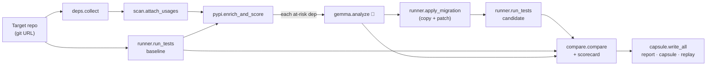

<div align="center">

# depexit

**Test the AI before you trust it.**

depexit finds the risky dependencies in a Python project, asks **Gemma 4** how to replace each one,
**applies that fix in a copy of the project and runs the real test suite**, then writes a
**Dependency Exit Capsule**: the evidence, the patch, a report page, and a script that replays it all.

Hackathon 2026 · Track 1: Best Use of Gemma 4 (Dependency Resilience) · Team TechLiers

[Problem](#1-problem-and-solution) ·
[Setup](#2-setup) ·
[Usage](#3-usage) ·
[Architecture](#4-architecture) ·
[Dependencies](#5-dependencies) ·
[AI model](#6-ai-model-details) ·
[Limitations](#7-known-limitations)

</div>

<!-- TODO(Radhesh): add docs/report.png (screenshot of the REAL run's report.html) here -->

---

## 1. Problem and solution

### The problem
Python projects rot without anyone touching them. Our target, **[LinkWatch](https://github.com/rishrek/LinkWatch)**
(the official starter repo), shows how:

- **Its own test suite fails today.** On Python 3.12, 9 of 10 tests pass. `test_report_renders_all_sites` fails
  with `ImportError: cannot import name 'soft_unicode' from 'markupsafe'`, because the pinned **Jinja2 2.11.3**
  breaks with today's MarkupSafe. Nobody changed LinkWatch; its dependencies moved.
- **Its two dependency files disagree:** `pydantic==1.10.13` in `requirements.txt`, `pydantic>=2` in `pyproject.toml`.
- **It relies on abandoned or deprecated code:** `appdirs`, `toml`, and setuptools' `pkg_resources` (which raises a
  `DeprecationWarning` during the tests).

A maintainer can ask an AI what to do, but AI answers can be confidently wrong, and nobody has time to check
each suggestion by hand.

### Our solution
depexit treats the AI's answer as a **claim to be tested**, not a fact:

1. **Find and score** every dependency using observable evidence (PyPI history, version gaps, the code, the baseline
   test run). ✅ verified
2. **Locate** every file and line that imports each risky dependency (the *blast radius*). ✅ verified
3. **Ask Gemma 4** for a migration plan, including the edited files and a **prediction**: "will this break any test
   that passes today?" 🤖 AI-suggested
4. **Test the plan**: apply it to a copy of the repo, install into a fresh Python 3.12 venv, run the project's own
   tests, and compare against the original run. ✅ verified
5. **Grade Gemma**: was its prediction right? The report's headline is **"Gemma was right about X of Y migrations."**

Throughout the output, **AI suggestions and verified evidence are kept visibly separate**. In `report.html`,
dashed outlines mean "Gemma claimed this" and solid fills mean "the tests showed this".

---

## 2. Setup

You need **Windows PowerShell**, **git**, **[uv](https://docs.astral.sh/uv/)** and **Python 3.12**
(LinkWatch's old dependencies don't install on newer Pythons).

```powershell
git clone https://github.com/rad117/H26_TechLiers_Track1.git
cd H26_TechLiers_Track1
uv python install 3.12                      # no uv? powershell -c "irm https://astral.sh/uv/install.ps1 | iex"
uv venv --python 3.12 .venv
.venv\Scripts\activate
uv pip install -r depexit/requirements.txt pytest
```

**Gemini API key** (for the Gemma step). Get a free key from Google AI Studio, then either set it for the session:

```powershell
$env:GEMINI_API_KEY = "<your key>"
$env:GEMMA_MODEL    = "gemma-4-31b-it"      # optional; see section 6
```

…or put the same `KEY=value` lines in a `.env` file in the project root. `.env` is gitignored: **never commit a key.**

No key? Run with `--no-ai` to get the verified facts and baseline tests without Gemma.

---

## 3. Usage

```powershell
python -m depexit analyze https://github.com/rishrek/LinkWatch --out capsule_out
start capsule_out\report.html
```

| Option | Default | What it does |
|---|---|---|
| `target` | (required) | Git URL or local folder of the project to analyse |
| `--out PATH` | `capsule_out` | Where to write the capsule |
| `--only PKG …` | all at-risk | Only migrate these dependencies, e.g. `--only Jinja2 appdirs` |
| `--max-deps N` | all | Migrate at most the N riskiest dependencies (each one takes about 20 s plus the Gemma call) |
| `--no-ai` | off | Skip Gemma: facts, scores and baseline tests only |
| `--no-tests` | off | Skip creating venvs and running tests |

Gemma's answers are cached in `capsule_out/ai/`, so a second run is fast and doesn't spend API quota.

### What you get: the Dependency Exit Capsule

```text
capsule_out/
├── report.html          ← the Blast Radius page: open it in any browser, works offline
├── summary.json         ← all data, plus a sha256 fingerprint of every evidence file
├── replay.ps1           ← re-runs every test from scratch: anyone can check our evidence
├── <dependency>/
│   ├── capsule.md       ← verified facts, then Gemma's suggestion, then open concerns
│   ├── capsule.json     ← the same, machine-readable
│   └── patch.diff       ← the exact change that was tested (applies with `git apply`)
├── ai/                  ← raw Gemma answers (cache and evidence trail)
└── _work/logs/          ← full output of every install and test run
```

**`report.html`** has three views of the same evidence:
- **Gemma vs Reality:** each migration's prediction (with Gemma's confidence) next to what the tests showed
- **What each fix did to the tests:** every test that failed in any run × every run; cells that changed are highlighted
- **Every dependency, riskiest first:** click any row for the full evidence, Gemma's plan, the patch and the open concerns

A real run against LinkWatch is committed in **[`example_output/`](example_output/)**.
<!-- TODO(Radhesh): commit the real run (without _work/, but WITH _work/logs/) as example_output/ -->

---

## 4. Architecture



| Step | Module | Owner | Output |
|---|---|---|---|
| 1. Clone the target | `__main__.py` | Sohan | `capsule_out/_work/target` |
| 2. Baseline tests on the **original** dependencies | `runner.py` | Sheersh | `TestRun` ✅ |
| 3. Read `requirements.txt` + `pyproject.toml` | `deps.py` | Sohan | `DepRecord`s ✅ |
| 4. Find every import with `ast` | `scan.py` | Sohan | usages (file, line, code) ✅ |
| 5. PyPI metadata + health score (0–100) | `pypi.py` | Sohan | signals, `at_risk` ✅ |
| 6. Ask Gemma 4 for each at-risk dependency | `gemma.py` | Sohan | `AIResult` 🤖 |
| 7. Apply the plan in a copy, re-run the tests, compare | `runner.py`, `compare.py` | Sheersh | `Comparison` ✅ |
| 8. Grade Gemma and write the capsule | `compare.py`, `capsule.py` | Sheersh, Radhesh | scorecard, capsule files |

The data passed between modules is plain JSON-serialisable dicts, specified in [`team/CONTRACT.md`](team/CONTRACT.md).

### How the health score works
`health_score = clamp(100 + sum of signal points, 0, 100)`; a dependency is **at risk below 70**. Every signal
records where its evidence came from, and a signal is only added when that evidence exists:

| Signal | Points | Fires when | Source |
|---|---|---|---|
| `fails_in_baseline` | −30 | a failing baseline test's error names this package (or one of its dependencies) | baseline tests |
| `major_behind` | −25 | pinned major version < latest major version | PyPI |
| `old_pin` | −20 | the pinned release is more than 3 years old | PyPI |
| `inactive` | −20 | no release for 2+ years, or an "Inactive" classifier | PyPI |
| `deprecation_warning` | −15 | a baseline pytest warning mentions this package | baseline tests |
| `spec_mismatch` | −15 | `requirements.txt` and `pyproject.toml` disagree | repo files |
| `private_api` | −10 | the code imports a `_private` name from it | code scan |
| `undeclared` / `unused` | −10 | imported but not declared / declared but never imported | code scan |
| `unpinned` | −5 | no version constraint anywhere | repo files |

### How we verify
<!-- TODO(Sheersh): replace or extend this paragraph with your own "How we verify" text -->
Every claim in the "verified" sections comes from a command we ran and logged:

- **Same conditions twice.** The original repo and each patched copy get their own fresh Python 3.12 venv (`uv venv`),
  install `requirements.txt` plus pytest, and run `pytest -W default --junitxml`. Results come from the JUnit XML,
  not from parsing text.
- **"Safe" is defined fairly.** A migration passes if it **installs and no test that passed before fails after it**.
  Tests that already failed on the original dependencies don't count against it, and Gemma is asked exactly that
  question.
- **Regressions can't hide.** A test that newly fails, a test that no longer runs at all, and a failed install all
  count as failures. A patch that edits test files is flagged, because it could make tests pass by weakening them.
- **AI output is treated as untrusted.** File edits are rejected if they resolve outside the project copy;
  requirement lines are rejected if they smuggle in pip options or a second package; the report renders AI text as
  plain text only.
- **Anyone can re-check.** Every command is recorded and written to `replay.ps1`, every log is kept, and
  `summary.json` stores a sha256 fingerprint of each evidence file.

---

## 5. Dependencies

**depexit itself** (`depexit/requirements.txt`):

| Package | Why |
|---|---|
| `google-genai` | Official Google Gen AI SDK, used to call Gemma 4 through the Gemini API |
| `requests` | PyPI JSON API lookups |

Everything else is the Python standard library: `ast` (import scanning), `tomllib` (pyproject.toml), `difflib`
(patches), `xml.etree` (JUnit results), `hashlib` (evidence fingerprints), `subprocess` (running git, uv and pytest).

**Tools:** `git` (cloning the target), `uv` (fast, isolated venvs and installs; falls back to `py -3.12 -m venv` +
pip), and `pytest` (installed into each test venv). **Development:** `pytest` runs depexit's own tests:

```powershell
python -m pytest depexit/tests -q
```

The report is one self-contained HTML file with no external scripts, fonts or CDNs, so it works offline.

---

## 6. AI model details

| | |
|---|---|
| **Model** | Gemma 4, instruction-tuned |
| **Version (model id)** | `gemma-4-31b-it` (set via `GEMMA_MODEL`), with automatic fallback to `gemma-4-26b-a4b-it` (`GEMMA_FALLBACK_MODEL`) when the first returns server errors. The model that actually answered is recorded in every result and shown in the report. <!-- TODO(Sohan): confirm the ids used in the example_output run --> |
| **Source** | Google DeepMind |
| **Access method** | Gemini API, through the official `google-genai` Python SDK |
| **Licence / terms** | <!-- TODO(Leena): exact licence name + link from the Gemma 4 model page (docs/model.md) --> See the Gemma terms at [ai.google.dev/gemma](https://ai.google.dev/gemma) |

**Its role in depexit:** for each at-risk dependency, Gemma receives only **verified facts** (the dependency's record
as JSON) plus the full text of the dependency files and of every source file that imports it. It must reply with
strict JSON: a risk explanation, the replacement, requirement changes, complete edited files, migration steps,
suggested tests, a **predicted outcome** and a **confidence**. Replies are validated, retried once if unusable, and cached.

**What Gemma is trusted for:** proposing. **What it is not trusted for:** deciding whether the fix works. Nothing
Gemma says is reported as working until the tests have run, and the scorecard measures how often its predictions
held up.

---

## 7. Known limitations

- **Tests only prove what they cover.** A migration can pass every test and still break an untested code path.
  Each capsule says so in its "open concerns" section.
- **Python projects only**, with dependencies in `requirements.txt` and/or `pyproject.toml`. Only
  `requirements.txt` is patched; `pyproject.toml` may still need a manual edit (flagged in the capsule).
- **One dependency at a time.** Each migration is tested on its own against the original code; we don't yet test
  combinations of fixes together.
- **Gemma can fail or time out.** The hosted model sometimes returns server errors or unusable JSON; we fall back to
  a second model and record any failure as "not tested" rather than guess.
- **Scores are heuristics.** The signal weights are our judgement, documented above, not a standard.
- **Windows-first.** The replay script is PowerShell, and the tool has been run on Windows 11 with Python 3.12.
- **The target must already have a test suite**; without tests there is nothing to verify against.
<!-- TODO(Sohan/Sheersh): add anything else you hit during the real run -->

---

## Team

| Member | Role |
|---|---|
| Sohan | Facts engine (deps, imports, PyPI scoring), Gemma 4 integration, CLI and integration lead |
| Sheersh | Proof engine: isolated test runs, migrations, comparison and the "Gemma vs Reality" scorecard |
| Radhesh | Dependency Exit Capsule, Blast Radius report, replay script, README and submission |
| Leena | Research, fact-checking Gemma against official sources, presentation |

## Licence

Released under the [MIT License](LICENSE). The `linkwatch/` code is the original LinkWatch project (MIT); its
original README is in [`LINKWATCH_README.md`](LINKWATCH_README.md). The `depexit/` tool was written by our team
during the hackathon and is also released under MIT.
